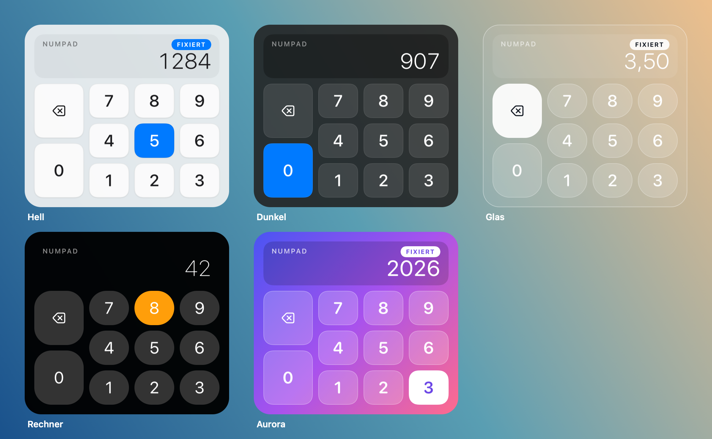

# TrackNum – Nummernblock auf dem Trackpad

Kleine macOS-Menüleisten-App: Solange die **rechte ⌘-Taste** gehalten wird (oder nach
kurzem Antippen fixiert ist), wird das **ganze Trackpad** zum Nummernblock: rechts die
Ziffern 1–9, links oben ⌫ (löscht ein Zeichen) und links unten 0, wie bei einem echten
Ziffernblock. Ein kleines Overlay rechts unten zeigt das Feld und die Eingabe.

```
 Trackpad
┌──────────────────┬───────┬───────┬───────┐
│                  │   7   │   8   │   9   │
│        ⌫         ├───────┼───────┼───────┤
├──────────────────┤   4   │   5   │   6   │
│                  ├───────┼───────┼───────┤
│        0         │   1   │   2   │   3   │
└──────────────────┴───────┴───────┴───────┘
```



## Bedienung

| Aktion | Wirkung |
|---|---|
| rechte ⌘ **halten** + Finger auf Feld | Ziffer wird sofort eingegeben, beim Loslassen ist der Modus wieder aus |
| rechte ⌘ **kurz antippen** | Numpad-Modus fixieren (Overlay zeigt „fixiert“) |
| nochmal antippen oder **Esc** | fixierten Modus beenden |
| rechte ⌘ + andere Taste | normales Tastenkürzel, der Numpad-Modus wird für diesen Druck abgebrochen |

Während der Modus aktiv ist, steht der Mauszeiger still und Klicks, Scrollen und Gesten
werden abgefangen, damit nichts versehentlich angeklickt wird. Die linke ⌘-Taste bleibt
unverändert für alle Kürzel.

Im Menüleisten-Icon (#) lässt sich einstellen:
- Aktivierungstaste: rechte ⌘ (Standard), rechte ⌥ oder fn/🌐
- Auslösen: **beim Berühren** (Standard, am schnellsten) oder **beim Klicken** (Finger dürfen aufliegen, erst der Klick zählt)
- **Ton beim Tippen**: ein kurzer, weicher „Thock“, ähnlich einer mechanischen Taste; er folgt der Systemlautstärke, bei Stummschaltung ist er still
- **Design**: Automatisch (folgt Hell/Dunkel des Systems), Hell, Dunkel, Glas (Liquid Glass), Rechner, Aurora; beim Auswählen erscheint eine kurze Vorschau
- **Vibration**: Aus / Leicht / Mittel / Stark; die Taptic Engine wird direkt angesteuert, beim Auswählen gibt es eine Vorschau
- Overlay ein/aus, bei der Anmeldung starten

## Bauen und installieren

```bash
./build.sh            # baut build/TrackNum.app
./build.sh install    # baut, installiert nach /Applications und startet
./build.sh test       # Selbsttest der Feld-Zuordnung
```

Beim ersten Start fragt macOS nach **Bedienungshilfen** (Systemeinstellungen →
Datenschutz & Sicherheit → Bedienungshilfen → TrackNum aktivieren). Ohne diese Freigabe
kann keine App Tasten senden oder Klicks abfangen. Die App wird mit dem eigenen
Apple-Development-Zertifikat signiert, deshalb bleibt die Freigabe auch nach einem Rebuild
erhalten.

Diagnose:
- `…/TrackNum --probe` gibt jede Berührung mit Koordinaten und erkannter Taste aus.
- `…/TrackNum --render datei.png` rendert alle Designs in ein Bild.
- `…/TrackNum --feedback` spielt sechs Klicks mit starker Vibration ab (Finger aufs Trackpad legen).

## Entwicklungsstrategie

**Ziel:** möglichst kurze Latenz (Finger → Ziffer), stabil im Dauerbetrieb, keine
Abhängigkeiten.

1. **Rohdaten vom Trackpad:** Das private `MultitouchSupport.framework` wird zur Laufzeit
   per `dlopen` geladen. Es liefert pro Frame (~120 Hz) alle Finger mit normierter Position
   (0…1), und zwar systemweit, unabhängig vom Fenster im Vordergrund. Diese Technik
   verwenden auch BetterTouchTool und ähnliche Apps.
2. **Ziffer schon beim Berühren:** Ein neuer Finger (Zustand *MakeTouch/Touching*) in der
   rechten Hälfte löst sofort aus, ohne auf Klick oder Abheben zu warten. Finger, die
   schon auflagen, als der Modus aktiviert wurde, werden ignoriert. Ein 45-ms-Schutz
   verhindert doppelte Eingaben.
3. **Zuordnung als reine Funktion** (`PadLayout`): rechts von `splitX = 0.5` ein 3×3-Raster
   über die volle Höhe, links oben ⌫ und links unten 0. Sie ist mit `--selftest` testbar.
4. **Tastenausgabe:** `CGEvent` mit echten Keypad-Keycodes (`kVK_ANSI_Keypad0…9`),
   Modifier-Flags explizit auf „Numpad“ gesetzt, damit die gehaltene ⌘ kein
   ⌘1 (Tab-Wechsel) daraus macht. Die Ausgabe ist unabhängig vom Tastaturlayout.
5. **Aktivierungstaste und Abfangen:** Ein `CGEventTap` läuft auf einem **eigenen
   Thread mit hoher Priorität**. So bremst die UI nie die Systemeingabe. Rechte und linke
   ⌘ werden über geräteabhängige Flag-Bits unterschieden. Halten = temporär,
   Antippen < 300 ms = fixieren. Klicks oder Tap-to-Click, die kurz nach dem Loslassen
   noch eintreffen, werden 300 ms lang ebenfalls abgefangen.
6. **Zuverlässigkeit:** Wird der Event-Tap vom System deaktiviert (Timeout), wird er sofort
   wieder aktiviert und der Tastenstatus neu synchronisiert. Nach dem Ruhezustand werden
   die Multitouch-Geräte neu registriert. Eine Frame-Lücke setzt den Fingerstatus
   zurück, und es läuft immer nur eine Instanz.
7. **Overlay:** Ein vorab erzeugtes, nicht aktivierendes `NSPanel` aus `CALayer`s ohne
   Animationen. Ein- und Ausblenden ist nur `orderFront`/`orderOut`, ein Tastendruck
   lässt das Feld 120 ms aufleuchten.
8. **Hintergrundbetrieb:** Menüleisten-App (`LSUIElement`), Autostart über
   `SMAppService` („Bei Anmeldung starten“).
9. **Tests:** Selbsttest der Zuordnung, Build, Start und Probe-Modus prüfen, dass das
   Trackpad gefunden wird. Den Praxistest mit echten Fingern machst du.

## Aufbau

| Datei | Inhalt |
|---|---|
| `Sources/MTBridge.h` | C-Struktur der Multitouch-Frames |
| `Sources/Multitouch.swift` | Laden des Frameworks, Geräte starten/neu starten |
| `Sources/PadLayout.swift` | Zuordnung Position → Taste |
| `Sources/Engine.swift` | Zustandsmaschine, Tastenausgabe |
| `Sources/InputTap.swift` | Event-Tap-Thread |
| `Sources/Feedback.swift` | Ton (synthetisiert, AVAudioEngine) und Taptic-Engine-Vibration |
| `Sources/Theme.swift` | Die Designs (Farben, Formen, Hintergrund) |
| `Sources/Overlay.swift` | Anzeige-Panel |
| `Sources/AppDelegate.swift` | Menüleiste, Einstellungen, Berechtigungen |
| `Sources/main.swift` | Einstieg, `--selftest`, `--probe` |
